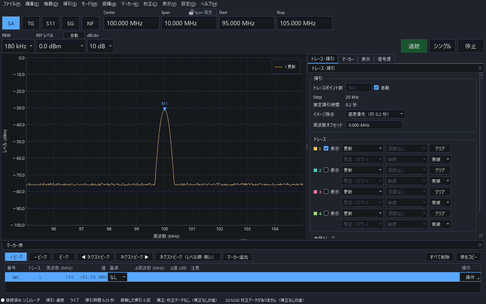
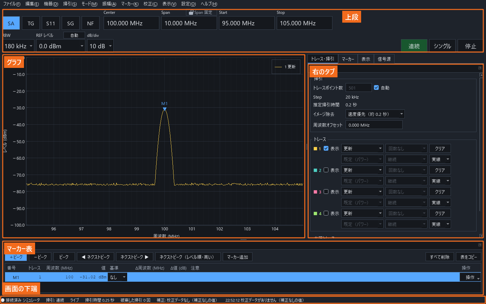
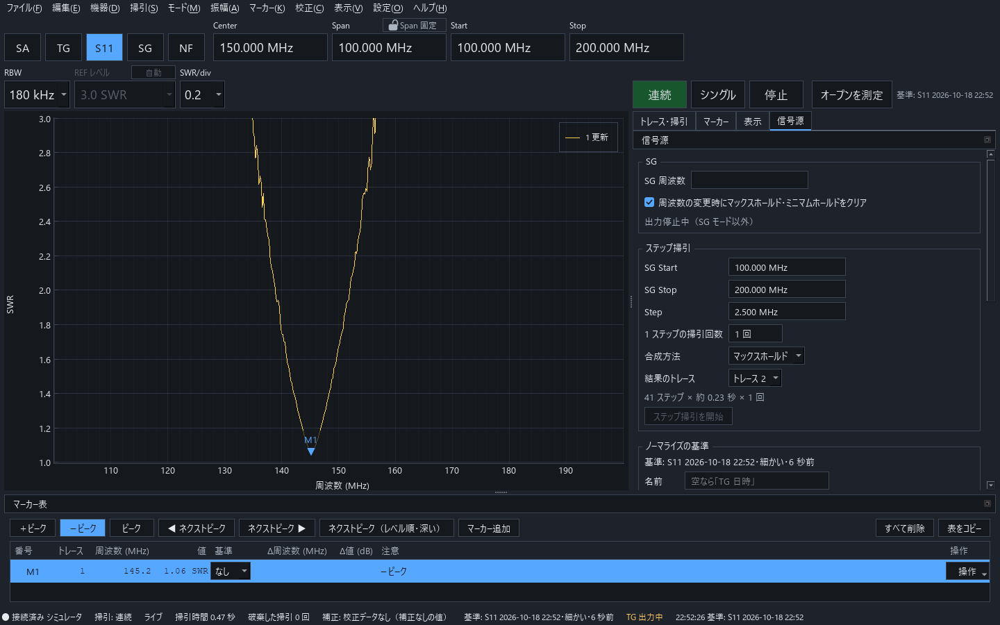
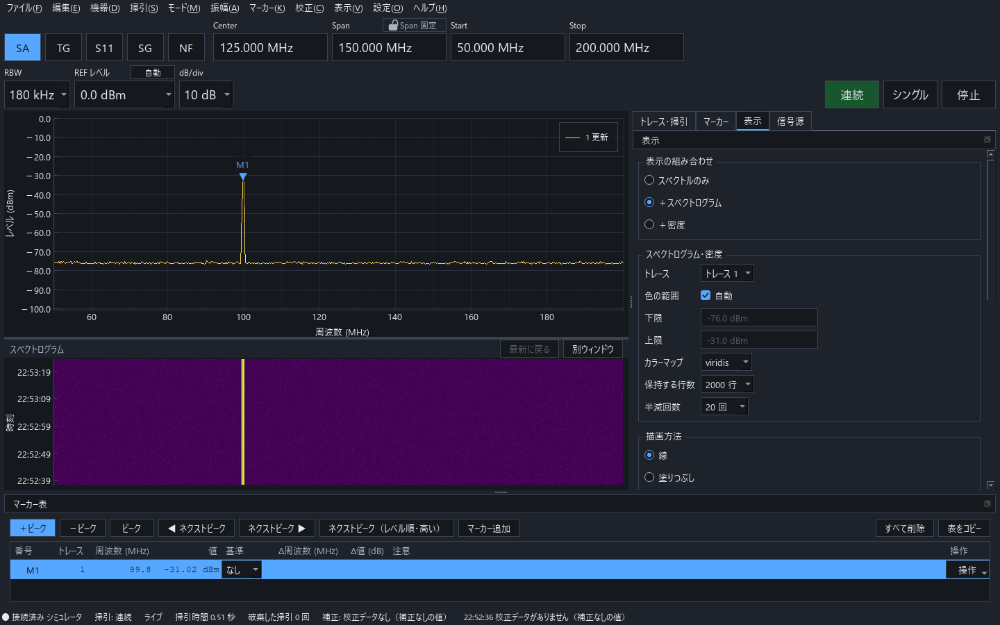

<p align="center">
  <picture>
    <source media="(prefers-color-scheme: dark)" srcset="assets/logo/namibench_logo_dark.png">
    
  </picture>
</p>

# NamiBench

自作スペクトラムアナライザ **GigaSt v5** を PC から操作するアプリケーションです。設定、掃引、マーカーでの読み取り、という計測器と同じ流れで使えます。

| 機器 | 対応モード |
| --- | --- |
| GigaSt v5 | SA（スペクトラムアナライザ）・TG（伝送特性）・S11（反射）・SG（信号源）・NF（NF 測定） |
| PlutoSDR | SA・TG・S11・SG、外部 IQ 送信 |
| RTL-SDR のドングル | SA のみ（受信専用）、音声モニタ、rtl_tcp |
| シミュレータ | 機器なしで画面と操作を試せます |

デスクトップの画面のほかに、同じ PC やスマートフォンのブラウザからも同じ機器を操作できます。



[機器] → [自己診断の結果] は開発中のため使用できません。

画面の写しは、すべて機器の代わりにシミュレータに接続して撮影したものです。

## 目次

- [必要なもの](#必要なもの)・[インストール](#インストール)・[起動と接続](#起動と接続)
- [画面の見方](#画面の見方)・[数値の入力](#数値の入力)
- [掃引の条件](#掃引の条件)・[掃引の実行](#掃引の実行)・[縦軸](#縦軸)・[トレース](#トレース)・[マーカー](#マーカー)・[ピークの一覧](#ピークの一覧)
- モード: [SA](#sa信号の観測)・[TG](#tg通過特性の測定)・[S11](#s11反射の測定)・[SG とステップ掃引](#sg-とステップ掃引)・[NF](#nf雑音指数の測定)・[ゼロスパン](#ゼロスパン)
- [スペクトログラムと密度表示](#スペクトログラムと密度表示)・[バンドプランとブックマーク](#バンドプランとブックマーク)
- [保存・開く・書き出し・PNG](#保存開く書き出しpng)・[記録と再生](#記録と再生)・[プリセット](#プリセット)
- [校正](#校正)・[単位・外部補正・周波数オフセット](#単位外部補正周波数オフセット)
- [RTL-SDR](#rtl-sdr)・[PlutoSDR](#plutosdr)・[ブラウザからの使用](#ブラウザからの使用)
- [レイアウトと別ウィンドウ](#レイアウトと別ウィンドウ)・[設定](#設定)・[キー操作](#キー操作)
- [トラブルシューティング](#トラブルシューティング)・[設定とデータの保存場所](#設定とデータの保存場所)

## 必要なもの

- Windows 10 / 11。Linux・macOS 用の `setup.sh` もありますが、動作を確認済みなのは Windows のみです
- [Python 3.13](https://www.python.org/downloads/)（64 ビット版）
- 機器と、その機器のドライバ
  - **GigaSt v5**: FTDI の USB シリアルのドライバ。Windows では、挿すと自動でインストールされることが多いです。インストールされない場合は、FTDI の VCP ドライバをインストールしてください
  - **RTL-SDR**: `rtlsdr.dll`（64 ビット版）と、[Zadig](https://zadig.akeo.ie/) で入れ替えた WinUSB のドライバ
  - **PlutoSDR**: Analog Devices の libiio（v0.26 以降の Windows 64 ビット版）

## インストール

1. Python 3.13（64 ビット版）をインストールします。
2. このリポジトリを取得します。`git clone https://github.com/imenihs/NamiBench.git` を実行するか、GitHub の [Code] → [Download ZIP] でダウンロードして展開します。
3. 取得したフォルダの `setup.bat` をダブルクリックします。次の処理をすべて行い、最後に「Done.」と表示されれば使用できます。
   - フォルダの中に `venv` を作成し、必要なパッケージをインストールします。ほかの PC からコピーした `venv` は再作成します
   - PlutoSDR に使う libiio（Analog Devices 公式の v0.26）をダウンロードして `libiio` フォルダに置きます
   - 動作を確認します。設定は書き換えません

インターネット接続が必要です。PlutoSDR を使う PC には、PlutoSDR の USB ドライバ（Analog Devices の「PlutoSDR-M2k-USB-Drivers」）を一度インストールしてください。

Python が見つからない場合は、Python の場所を指定して実行します。PowerShell では `.\setup.bat` と入力します。

```bat
setup.bat C:\path\to\python.exe
```

Linux / macOS では `./setup.sh` を実行します。Python を指定する場合は `./setup.sh /path/to/python3` を実行します。

### 別の PC への移行

1. この PC で `pack.bat` をダブルクリックします。`NamiBench_pack.zip`（git の管理対象のファイルのみ。`venv` などは含みません）が作成されます。
2. `NamiBench_pack.zip` と `setup.bat` を、別の PC の同じフォルダに置きます。
3. その `setup.bat` をダブルクリックします。`NamiBench` フォルダに展開し、上の 3. と同じ準備をします。

## 起動と接続

`run.bat` をダブルクリックします。Linux / macOS では `venv/bin/python -m namibench` を実行します。

- 起動すると、前回使った機器に自動で接続し、「前回の GigaSt に接続しました」と1回表示します。シミュレータには自動で接続しません
- 接続できない場合は、機器の一覧が開きます。使う機器の [接続] を押してください。機器なしで試す場合は、[シミュレータに接続] を押します
- 別の機器に切り替える場合は [機器] → [機器に接続…]、切断する場合は [機器] → [切断] を選びます
- 機器の一覧の状態の意味:

| 状態 | 意味 |
| --- | --- |
| 使用可能 | 接続できます |
| 使用中 | このアプリケーションが接続中です |
| 接続履歴あり | 以前に接続したことがある機器です |
| ほかのアプリケーションが使用中 | GS5.exe などが COM ポートを使用中です。閉じてから [接続] を押してください |
| 未登録 | 接続の前に、GigaSt かどうかを確認します |
| DLL が見つかりません | RTL-SDR・PlutoSDR の DLL がありません（[RTL-SDR](#rtl-sdr)・[PlutoSDR](#plutosdr)） |

- USB を抜くと「切断・再接続待ち」になり、同じ機器を挿し直すと再接続されます
- GigaSt は USB 給電なので、USB の抜き挿しは電源の再投入になります。TG・SG の出力レベルは電源を入れるたびに変わります

## 画面の見方



- **上段**: Center・Span・Start・Stop・RBW・REF レベル・dB/div と、右端の [連続] [シングル] [停止] です。TG では [基準を取得]、S11 では [オープンを測定] [ショートを測定] も表示されます。掃引に1秒より長くかかる場合は、掃引の進捗の棒と割合が表示されます
- **グラフ**: 波形を描画します。操作は次の表のとおりです
- **マーカー表**: グラフの下にあり、マーカーの周波数とレベルを読み取ります
- **右のタブ**: [トレース・掃引] [マーカー] [表示] [信号源] の4つです
- **画面の下端**: 接続の状態、TG・SG 出力中、記録中、注意などが表示されます

| グラフの操作 | 動き |
| --- | --- |
| 横にドラッグ | その範囲を Start・Stop にして拡大します |
| 周波数軸の上でホイール | カーソルの位置を中心に拡大・縮小します |
| レベル軸の上でホイール / ドラッグ | REF レベルを1目盛ずつ / 連続で動かします |
| レベル軸の上で Ctrl+ホイール | dB/div を1段切り替えます |
| クリック / ダブルクリック | 近いトレースにマーカーを配置します |
| 右クリック | [ここを Center に] [ここにマーカーを配置] [REF をここに] [ここを X1 に] [ここを X2 に] [ここをブックマークに…] などを選べます。[REF をここに] には、その位置のレベルが表示されます |
| マウスを置く | 最も近いトレースの点の周波数とレベルを表示します |
| ファイルをドラッグ&ドロップ | そのファイルを開きます |

使用できない項目は、非表示にせず灰色で表示します。灰色の項目にマウスを置くと、使用できない理由が表示されます。

## 数値の入力

- 単位を付けて入力できます（`1.2G`・`300k`・`1500`）。単位を省くと、その欄の単位として読み取ります
- Enter・Tab を押すか、欄を離れると確定します。Esc を押すと入力前の値に戻ります
- ↑↓ とホイールは、カーソルのある桁を増減します。ホイールで変わるのは、クリックして選択した欄のみです。画面をスクロールしても、欄の値は変わりません
- 機器が受け付けない値は近い値に合わせ、「◯◯MHz に合わせました」と1回表示します
- 条件の変更は Ctrl+Z か [編集] → [元に戻す] で元に戻し、Ctrl+Y か [編集] → [やり直し] でやり直せます

## 掃引の条件

- **Center・Span・Start・Stop**: どちらの組で入力しても構いません。Span に `0` を入力すると[ゼロスパン](#ゼロスパン)になります
- **Span 固定**: Span の欄の [Span 固定] をオンにすると、Span は Span の欄に入力したときだけ変わります。Center・Start・Stop の入力やグラフのドラッグでは幅を保ち、範囲を超える分は位置が動きます。オフの場合は、Center を変えたときは Center を保ち、範囲を超える分だけ Span を縮めます
- **RBW**: GigaSt は 180kHz・30kHz・15kHz です。使用できない RBW は一覧に灰色で残り、理由が表示されます。TG・S11・NF と、Span が 50MHz を超える場合は 180kHz のみです。欄が注意の色になった場合は、ツールチップに読み取りの注意が表示されます
- **トレースポイント数**（[トレース・掃引] タブ）: 既定は自動です。手動では最大 12000 点まで選べます
- **推定掃引時間**（[トレース・掃引] タブ）: 現在の条件で1画面にかかる時間です
- **イメージ除去**（[トレース・掃引] タブ）: GigaSt が掃引ごとに出す偽のピークを、複数回の測定で除去します。[精度優先] [速度優先] [なし] から選び、それぞれの推定時間（秒）が表示されます。何回かの掃引の両方に出た信号だけを残すので、短時間だけ現れる信号は表示されません。短時間の信号を観測するときは、[なし] とマックスホールドを使用してください

## 掃引の実行

- [連続]（F5）: 連続掃引します
- [シングル]（F6）: 1画面だけ掃引して停止します。押すたびに平均・ホールドに1画面ずつ加えます
- [停止]（F7）: 現在の掃引の終わりで停止します
- Pause キーで連続掃引と停止を切り替えます

## 縦軸

- **REF レベル**: グラフの最上部の目盛線のレベルです。入力するか、一覧（+20〜−120dBm）から選びます
- **dB/div**: 1目盛の大きさ（1・2・5・10dB）です。REF レベルと dB/div を変えても、測定値は変わりません
- **自動**: 表示中のトレースの最大値が、上から1目盛下に来るように REF レベルを調整します。[振幅] → [REF レベルを自動調整] も同じ動作です
  - 局部発振器の漏れ・TG の範囲外・掃引の始めの不安定な点・値のない点は、調整に使用しません
  - 使用できる点がない場合は [自動] を使用できません。灰色の [自動] にマウスを置くと「調整に使用できる点がありません」と表示されます

## トレース

[トレース・掃引] タブで、トレース 1〜4 を行ごとに設定します。

| 欄 | 選択肢 |
| --- | --- |
| 表示 | グラフに表示するか |
| 動作 | [更新]・[マックスホールド]・[ミニマムホールド]・[平均]・[ビュー]。[ビュー] は値を更新せずに残します |
| 回数 | 平均・ホールドの回数（1〜10000、または [回数なし]） |
| 平均の種類 | [既定（パワー）]・[パワー]・[対数]・[電圧]。先頭の項目は機器の既定の種類で、括弧の中が実際の種類です。対数はノイズが約 2.5dB 低く読めます |
| N 回に達した後 | 平均は [指数平均] か [N 回ごとにリセット]、ホールドは [継続] か [N 回で停止] |
| 線 | [細線]・[実線]・[太線]・[破線]・[点線] |
| クリア | このトレースの蓄積をクリア |

- 周波数軸・RBW・モード・イメージ除去・校正データ・基準などを変えると、値の意味が変わるので蓄積をクリアし、トレースの行に「条件変更（RBW）でリセット」のように、変えた条件が表示されます。REF レベル・dB/div・色を変えてもクリアしません
- **参照トレース**: 開いた保存ファイルのトレースをグラフに重ねます（[保存・開く](#保存開く書き出しpng)）。一覧の [閉じる] でグラフから外します

## マーカー

マーカーには P（ピーク）と M（手動）があり、それぞれ最大 8 まで配置できます。P はピークトラックを使用できます。M は周波数を固定するので、ピークトラックは使用できません。

### 配置と移動

- グラフをクリックするか、マウスの位置で `M` を押すと配置します。周波数を入力しても配置できます
- `P` で選択中のマーカーを最も高いピークへ、`[` `]` で左右のネクストピークへ移動します。[マーカー] メニューには [ネクストピーク（レベル順・高い）] と、最も高いピークに M を追加する [マーカーを追加] もあります。マーカー表の上の [マーカー追加] も同じです
- `←` `→` で1点ずつ、Shift+`←` `→` で10点ずつ移動します。これらのキーはグラフの上で有効です。[マーカー] メニューの [マーカーを左へ 1 点移動] [マーカーを右へ 1 点移動] も同じ動作で、Shift を押しながら選ぶと10点ずつ移動します
- マーカー表の上の [−ピーク] を押すか、[マーカー] → [＋ピーク／−ピークを切り替え] を選ぶと、−ピークを検索します。メニューの項目は [−ピークサーチ] [ネクスト −ピーク（左）] [ネクスト −ピーク（右）] [ネクストピーク（レベル順・深い）] に変わります。ノッチや S11 の共振を読み取るときに使います
- **ピークトラック**（[マーカー] タブ）: 掃引ごとに近くのピークを検索し直します。P のマーカーでのみ使用できます

### 読み取り

- マーカー表に周波数とレベルが表示されます。セルをダブルクリックすると周波数を修正できます
- **デルタ**: 行の [基準マーカー] で別のマーカーを選ぶと、その行に Δ周波数・Δ値が表示されます
- **オフセット**: [オフセット] の欄で [周波数] か [レベル] と、[+Δ] [−Δ] [±Δ] のどれかを選び、値を入力して [追加] を押すと、選択中のマーカーからその差の位置に線を表示します。値は、周波数なら `10M` のように単位を付けて、レベルなら dB の値を入力します。元との差を読み取るときに使います
- **XY カーソル**: 周波数の縦線 X1・X2 とレベルの横線 Y1・Y2 を、ドラッグか数値の入力で自由に配置し、ΔX・ΔY を読み取ります
- **マーカーの機能**:
  - [N dB 帯域幅]: 下端・上端・帯域幅・中心・Q を表示します。−3dB 帯域幅なら N に 3 を入力します。[シェープファクタ] をオンにして2つ目の N を入力すると、シェープファクタも表示されます
  - [しきい値との交点]: そのレベルの [以上] か [以下] の範囲の幅を表示します。例えば S11 で SWR 2 以下の帯域を読み取れます
  - [交点の線をグラフに出す] をオンにすると、交点のレベル（横線）と周波数（縦線）を、マーカーの色の薄い点線で表示します。この線は掃引ごとに動きます。ドラッグで動かす XY カーソルとは別のものです

### 条件の変更

マーカーの行・右クリック・メニューから、[マーカーの周波数を Center に] [マーカーの値を REF レベルに] [デルタマーカーの 2 点を Start・Stop に] を実行できます。

### 削除とコピー

Delete で選択中のマーカーを削除します。[すべてのマーカーを削除] [マーカー表をコピー（タブ区切り）] もあります。

## ピークの一覧

[マーカー] タブの [ピークの一覧] で、表示範囲の＋ピーク（または −ピーク）を一覧にします。

- SA では [ノイズフロアから] 何 dB 高い＋ピークを、TG・S11 では [最大から] 何 dB までの＋ピーク・−ピークを並べます
- 行の [P に登録] でマーカーにします。[上位] の欄に数（N）を入力して [に P を配置] を押すと、上位 N のピークにまとめて P を配置します。行の [Center に] で、そのピークを Center にも設定できます
- SG・TG・S11 のときは、GigaSt の内部スプリアスの周波数に「内部スプリアス」の印が付きます

## SA（信号の観測）

1. [モード] → [SA（スペクトラムアナライザ）]（Ctrl+1）を選びます。
2. GigaSt の SP 入力に、測定する信号を入力します。
3. Center と Span（または Start と Stop）を入力します。例: Center `433.92M`、Span `2M`。
4. [連続] で掃引し、`P` でピークにマーカーを配置して読み取ります。

0Hz 付近には局部発振器の漏れの帯が表示されます。入力の信号ではありません。負の周波数の側は正の周波数の鏡像です。

## TG（通過特性の測定）

フィルタやアンプの周波数特性を測定します。GigaSt の TG は 1〜4000MHz です。

1. [モード] → [TG（伝送特性）]（Ctrl+2）を選びます。
2. 測定する範囲を Start・Stop で設定します。
3. 被測定物だけを外し、TG 出力と SP 入力を接続します。ケーブルやアッテネータは測定時と同じものを使います。
4. 上段の [基準を取得] を押します。基準を取得すると、グラフが 0 dB 付近の線になります。
5. TG 出力と SP 入力の間に被測定物を入れます。グラフが基準との比（dB）になります。
6. マーカーの [N dB 帯域幅] などで読み取ります。

### ノーマライズの基準（[信号源] タブ）

- 基準は名前を付けて複数持てます。一覧から1つを選んで使い、名前の変更や削除ができます。アプリケーションを閉じても残ります
- [全範囲で取得] は TG の範囲を 1MHz ステップで取得します。上段の [基準を取得] と同じ動作です。0.2dB 級の精度が必要な場合は、[現在の条件で取得] で現在の範囲だけ取得し直します
- **基準の値**: 基準の取得時に dB の値を加算できます。例えば、アンプの利得を測定するときに測定時だけ 40dB のアッテネータを入れる場合は `+40` を入力します。後から [基準の値…] で修正できます
- 基準は、取得時のイメージ除去と RBW のときだけ使えます。一致しない場合は比ではなく受信電力（dBm）で表示され、理由が表示されます
- 基準の範囲外の点は「値なし」になり、線が途切れます
- USB の抜き挿しで GigaSt の電源を再投入すると出力レベルが変わるので、基準に「電源再投入前」の印が付きます。基準を取得し直してください

## S11（反射の測定）

外付けの方向性結合器を使って、リターンロス・|Γ|・SWR を測定します。位相は測定できません。

1. [モード] → [S11（反射）]（Ctrl+3）を選びます。
2. 結合器の、被測定物を接続する端子にオープンを接続し、上段の [オープンを測定] を押します。
3. オープンを外してショートを接続し、[ショートを測定] を押します。
4. 被測定物を接続します。



- 縦軸はリターンロス・|Γ|・SWR から選びます。|Γ|・SWR の縦軸は下端が固定のため、REF レベルはありません
- S11 から別のモードに切り替えたとき、電源を再投入したとき、イメージ除去や周波数軸を変えたときは、測定したオープンを破棄します。オープンから測定し直してください

## SG とステップ掃引

### SG（Ctrl+4）

- [信号源] タブの [SG 周波数] で周波数を設定して出力します（GigaSt は 1〜4000MHz）。GigaSt では出力レベルを変更できません
- 出力停止中は、「出力停止中（SG モード以外）」のように、その原因が表示されます
- [周波数の変更時にマックスホールド・ミニマムホールドをクリア] をオンにすると、SG の周波数を変えたときにマックスホールド・ミニマムホールドをクリアし、新しい周波数から重ね直します。オフにすると、前の周波数の分を残したまま重ねます。ただし「N 回で停止」のホールドはクリアします。平均は、この設定によらず常にクリアします

### ステップ掃引（[信号源] タブ）

SG の周波数を 1 ステップずつ変更しながら掃引し、結果を合成します。周波数変換器の特性や、フィルタの形を細かく観測する場合に使います。

- [SG Start] [SG Stop] [Step] [1 ステップの掃引回数] [合成方法]（[マックスホールド]・[平均]・[すべて重ねる]）[結果のトレース] を設定して、[ステップ掃引を開始] を押します
- 停止するときは [停止] を押します。そこまでの結果は残ります
- 終了すると SG の周波数は開始前の値に戻り、結果はビューのトレースとして残ります

SG・TG・S11 のときは、GigaSt の内部スプリアスの周波数にグラフの上端で印が付きます。[内部スプリアスの印] でオフにできます。

## NF（雑音指数の測定）

ノイズソースの ON/OFF を掃引ごとに切り替えて、Y 係数法で NF を求めます（Ctrl+5）。

- [信号源] タブの [NF] で ENR を入力します。周波数ごとの ENR は [CSV を取り込む…] で表を取り込みます。表は、1列目が周波数、2列目が ENR の CSV です
- 必要な機器（約 80dB のアンプとイメージ除去の BPF）と接続は [NF 測定の接続…] で確認できます
- 平均はトレースの [平均] で設定します
- NF の利得は [校正] → [NF の利得…] で測定します

## ゼロスパン

Span に `0` を入力すると、横軸が時間になります。時刻は推定値です。

- [表示] タブの [表示する長さ] で、[掃引1回]・[1 秒]・[10 秒]・[60 秒] を選びます。[掃引1回] は現在の掃引を時間軸で表示します。秒を選ぶと、掃引を続けて横軸を時間で流し、古い掃引ほど左に表示します。掃引と掃引の間は測定を行わないため、その部分は空白になります
- マーカーで時刻とレベルを、XY カーソルで Δ時間・Δレベルを読み取ります
- X1〜X2 の区間の最大・最小・パワー平均が表に表示されます。X1・X2 が未配置の場合は、表示範囲の値です
- 周波数を使う操作（Center に、N dB 帯域幅、ピークの一覧、スペクトログラムなど）は使用できません

## スペクトログラムと密度表示

[表示] タブの [表示の組み合わせ] で、[スペクトルのみ] [＋スペクトログラム] [＋密度] を選びます。[表示] → [スペクトログラム]、[表示] → [密度表示] でも切り替えられます。境目をドラッグすると高さを変更できます。



- **スペクトログラム**: 1回の掃引を1行として上に追加します。行をクリックすると、その時刻の掃引を「過去の掃引」としてスペクトルに重ねます。左の時刻の目盛の上をドラッグするとその時間の範囲を、ホイールで前後を表示します。[最新に戻る] で最新の掃引の表示に戻ります
- **密度表示**: 直近の掃引で、各周波数・レベルに何回来たかを色で表示します。ときどき出る信号や揺れる信号を観測できます
- [スペクトログラム・密度] の欄で、使うトレース、色の範囲（自動か下限・上限）、カラーマップ（viridis・cividis・magma・inferno・灰色）、保持する行数、密度の [半減回数] を設定します

## バンドプランとブックマーク

[表示] タブの [バンドプラン・ブックマーク] で、周波数帯の色分けとブックマークをグラフに重ねます。

- [取り込む…] [書き出す…] で JSON のファイルを取り込み・書き出しします。グラフの右クリックの [ここをブックマークに…] でブックマークを追加できます。ブックマークの [Center に] でその周波数へ移動します
- ファイルの形式（周波数は Hz の整数、色は `#rrggbb`。空の見本は `namibench/core/bandplan_sample.json`）:

```json
{"format": "pygigast-bandplan", "version": 1,
 "bands": [{"name": "430MHz 帯", "start_hz": 430000000, "stop_hz": 440000000, "color": "#4fa3ff"}],
 "bookmarks": [{"name": "ビーコン", "hz": 434500000}]}
```

## 保存・開く・書き出し・PNG

| 操作 | キー | 内容 |
| --- | --- | --- |
| 保存… | Ctrl+S | トレース・マーカー・条件・校正・基準を HDF5（`.h5`）に保存します。h5py・MATLAB・HDFView などで読めます。メモを付けられます |
| 開く… | Ctrl+O | 保存ファイルを参照トレースとして重ねます。記録のファイルは再生します。いくつでも開けます |
| CSV に書き出す… | Ctrl+E | 周波数の範囲（[現在の表示]・[数値で指定]・[トレースのすべての点]）とトレースを選んで書き出します。1行目に測定の条件が入ります |
| PNG を保存 | Ctrl+P | グラフ・マーカー表・測定の条件を1枚の画像にします。ファイル名を1回通知し、そこからフォルダを開けます |
| PNG をクリップボードにコピー | Ctrl+Shift+C | 同じ画像をクリップボードにコピーします |

PNG のサイズ・配色（[ユーザー指定]・[ライト]・[ダーク]）・保存先は設定の [保存] ページで、画像の下端に焼き込む1行のメモは [表示] タブの [PNG] で設定します。

## 記録と再生

- [ファイル] → [記録を開始] で掃引を連続して記録し、[記録を停止] で停止します。[記録を保存…] で保存ファイル（HDF5）にします
- 記録は1回の掃引ごとに作業ファイルへ書き込むので、アプリケーションや PC が異常終了しても直前の掃引まで残ります。保存前に終了した記録は、次の起動時に [保存…] [破棄…] [あとで] のどれにするかを確認します
- 記録のファイルを開くと再生します。スペクトログラムの下の帯で [再生] [一時停止]、[再生速度]（等倍〜30 倍）、時間のつまみを使い、[ライブに戻る] で測定に戻ります
- [ファイル] → [記録を抽出…]、[ファイル] → [記録を CSV に書き出す…] で、選択した時間の範囲と、現在の周波数の表示範囲を書き出します。時間の範囲が未選択の場合は、記録の全体を書き出します
- ゼロスパン・NF の区間がある記録は再生できません

## プリセット

よく使う条件に名前を付けて保存し、呼び出します。

- [ファイル] → [現在の状態をプリセットに保存…] で保存し、[ファイル] → [プリセット…] で呼び出し・上書き・名前の変更・削除を行います
- 含まれるもの: モード・Start/Stop・RBW・トレースポイント数・イメージ除去・SG の周波数・REF レベル・dB/div・単位・外部補正・トレースの動作と回数・平均の種類・表示の組み合わせ・周波数オフセット
- 含まれないもの: 校正データとノーマライズの基準
- 呼び出した後も Ctrl+Z で元に戻せます

起動時は、プリセットとは別に、前回終了時の状態に戻ります。

## 校正

[校正] メニューから、手順を案内する画面で校正します。[準備] → [測定] → [確認] → [保存] の順に進み、保存するまで何も変わりません。以前の校正データは履歴に残ります。

| メニュー | 必要な機器 | 内容 |
| --- | --- | --- |
| 周波数特性と全体のレベル… | 外部の SG・ケーブル | 外部の SG の出力を SP 入力へ接続し、案内される周波数ごとに測定します。測定できない点はスキップできます |
| RBW… | ケーブル 1 本 | TG 出力と SP 入力を直結して、RBW ごとの差を自動で測定します |
| NF の利得… | 6dB のアッテネータ | アッテネータありとなしの両方で測定します |
| PlutoSDR の利得の補正… | 30〜40dB のアッテネータ・ケーブル 2 本 | PlutoSDR の TX からアッテネータを通して RX へ接続します |
| 旧校正ファイルを取り込む… | 旧校正ファイル | GS5.exe の校正ファイル（`gigast.txt` / `ba205.txt` と個別補正データ）を取り込みます |

旧校正ファイルは、接続中の GigaSt に取り込みます。GS5.exe の設定ファイルと保存ファイルは読み込めません。

## 単位・外部補正・周波数オフセット

- **単位**（[表示] タブの [振幅の詳細]）: 電力の読み値の単位で、dBm・dBμV・dBmV から選びます（50Ω で換算）。グラフ・マーカー・CSV・PNG・REF レベルが同じ単位になります。TG・S11 で基準との比を表示中は dB、NF モードでは dB（NF）になります
- **外部補正**（同じ欄）: 外付けのアッテネータ・アンプの分を加算します（10dB の減衰なら `+10`）。0 以外の場合は画面の下端に表示されます
- **描画方法**（[表示] タブ）: 線か塗りつぶし
- **周波数オフセット**（[トレース・掃引] タブ）: 周波数変換器を観測するときに使います。表示する周波数は「測定周波数 + オフセット」になります。オフセットには負の値も入力できます。機器へ送る周波数は変わりません。CSV には測定周波数も残ります

## RTL-SDR

### 準備

1. Zadig で、ドングルのドライバを WinUSB に入れ替えます。
2. `rtlsdr.dll`（64 ビット版）を、アプリケーションのフォルダの `rtlsdr` フォルダに置きます。別の場所に置いた場合は、設定の [RTL-SDR] ページで [フォルダを選択…] からそのフォルダを選択します。
3. ドングルを挿すと、機器の一覧に表示されます。

### 使い方

- 受信専用です。TG・S11・SG・NF は使用できません
- レベルは「dB（未校正）」で、絶対値（dBm）ではありません
- [トレース・掃引] タブの [受信（RTL-SDR）] で、受信の利得と周波数の補正（ppm）を設定します。受信の利得は、手動の段か [AGC] から選びます。[AGC] はドングルの自動利得制御です
- [利得を自動調整] は、表示中の信号が過大入力にならない最大の利得の段を選びます。段を上から順に短い時間で測定して試します。選択後、トレースをクリアします
- **個体の校正**: マーカーを既知の周波数の信号に配置して [ppm をこの信号で校正] を、既知のレベルの信号に配置して [レベルをこの信号で校正] を押すと、その利得の段は dBm で表示されます。シリアル番号ごとに保存します
- RBW の窓は Hann（周波数を細かく分離する用途）と Flat top（レベルを正確に読み取る用途）から選びます
- **音声モニタ**（[マーカー] タブ）: 選択中のマーカーの周波数を [AM]・[狭帯域 FM]・[FM 放送]・[USB]・[LSB] で復調して音声にします。[マーカー] → [選択中のマーカーで音声モニタ]、[音声モニタを停止] でも同じ操作ができます。音声モニタ中は掃引を停止します
- **rtl_tcp**（設定の [rtl_tcp] ページ）: [送り出す] をオンにすると、SDR# などのソフトウェアから RTL-SDR として使えます。[接続元] は [この PC のみ] か [同じネットワークのほかの PC からも] です。クライアントの接続中は掃引しません。GigaSt からも送出できますが、送るのは信号のレベルのみなので、外部のソフトウェアで復調できるのは AM のみです

## PlutoSDR

### 準備

1. libiio の DLL 一式（`libiio.dll` と、同じフォルダにある DLL）を、アプリケーションのフォルダの `libiio` フォルダに置きます。別の場所に置いた場合は、設定の [PlutoSDR] ページでそのフォルダを選択します。
2. PlutoSDR を USB で接続すると、機器の一覧に表示されます。検索先は `ip:192.168.2.1` です。変更する場合は、設定の [PlutoSDR] ページの [URI] で変更します。

### 使い方

- レベルは「dB（未校正）」です。[校正] → [PlutoSDR の利得の補正…] で利得の段の差を補正できます
- [トレース・掃引] タブの [受信（PlutoSDR）] で、受信の利得を手動の値か [自動] から選びます。[利得を自動調整] は、表示中の信号が過大入力にならない最大の利得を選びます。選択後、トレースをクリアします
- SG・TG・S11 の出力レベルは、[信号源] タブの [送信（PlutoSDR）] の [送信の減衰] で設定します
- [TG 高調波の平均除去]（[なし]・[4回]・[8回]）で、TG・S11 の値の揺れを低減します。1000MHz より下の位置で、送信と受信の局部発振器を合わせ直して読むのを回数分くり返し、電力を平均します。送信の高調波で値が揺れるのを減らせますが、掃引時間は延びます。回数を変えても、トレースの蓄積と基準はそのまま使えます
- 比の下限（測定できる深さの限界）は、TG 高調波の平均除去では下がりません。深く測定する場合は、送信の出口に測定する帯域に合ったフィルタ（BPF か LPF）を入れてください
- 設定の [PlutoSDR] ページの [基準の補正] で、機器の基準の水晶発振子（40MHz）の周波数偏差（ppm）を補正します。送信・受信の周波数とサンプリング周波数が同じ割合で合います。補正は PlutoSDR ごとに保存し、接続したときに機器へ書き込みます。0 の場合は書き込まず、機器の値のまま使います
- **外部 IQ 送信**（設定の [外部 IQ 送信] ページ）: [受け付ける] をオンにすると、ほかのアプリケーションが TCP で送った IQ を PlutoSDR から送信します。SA モードのときに使えます。最小のクライアントの例は `tools/ext_iq_client.py` です。送信は必ずケーブルとアッテネータで被測定物へ接続し、空中に放射しないでください

## ブラウザからの使用

この PC のブラウザから使う場合は、`--web` を付けて起動し、`http://127.0.0.1:8080/` を開きます。設定の [ブラウザからの使用] ページの [この PC のブラウザから使う] をオンにしても使えます。

```bat
run.bat --web
```

- スマートフォンや別の PC から使う場合は、設定の [ブラウザからの使用] ページで [同じネットワークのスマートフォンや PC からも使う] をオンにします。QR コード（操作可・閲覧のみの2つ）・URL・6桁の認証番号が表示されるので、スマートフォンのカメラで QR コードを読み取るか、URL を開いて認証番号を入力します。認証番号は 2 分で無効になります
- 接続方法は [設定] → [ブラウザからの接続方法…] で開き直せます。開き直すと、新しい認証番号が表示されます。画面の下端の [ブラウザから接続] から、接続中のブラウザの一覧・切断・認証の再作成ができます
- [同じネットワークのスマートフォンや PC からも使う] は、アプリケーションを起動するたびにオフになります。使う場合は、もう一度オンにしてください
- 暗号化（HTTPS）は未対応です。信頼できないネットワークでは使わないでください。インターネットには公開しないでください
- ブラウザの画面はデスクトップの画面と同じ構成・同じ操作です。保存・書き出し・PNG はブラウザへのダウンロードになり、開くファイルはブラウザからアップロードします。DLL のフォルダなど PC の場所を指す設定は、デスクトップの画面で変更します
- 画面なしで動かす場合は `run.bat serve` を、スマートフォンからも使う場合は `run.bat serve --lan` を実行します。URL・QR コード・認証番号はコンソールに表示され、Enter で新しい認証番号、`r` と Enter で認証を再作成します

## レイアウトと別ウィンドウ

- グラフとマーカー表の境目、右のパネルの幅はドラッグで変更できます。変更した幅は次の起動時にも残ります
- グラフ・マーカー表・右のタブ（タブごと）・ピークの一覧は、別ウィンドウに表示できます。[表示] メニューの [グラフを別ウィンドウで開く] などの項目を選びます。スペクトログラム・密度表示・ピークの一覧は、その部分の [別ウィンドウ] でも開けます。タブは複数を同時に別ウィンドウで開けます
- デスクトップの画面では、マーカー表と右のタブのタイトルバーの右端のボタンでも、別ウィンドウにしたり戻したりできます。別ウィンドウのタイトルバーをドラッグして元の画面の上に動かすと、付け直せます
- ブラウザの画面では、タブの帯の右端の [別ウィンドウ] で、表示中のタブを別ウィンドウで開きます
- 別ウィンドウは、閉じると元の位置に戻ります
- 別ウィンドウを見失った場合は、[表示] → [レイアウトを初期に戻す] で戻します

## 設定

[設定] → [設定…] で開きます。変更はすぐに反映されます。各項目の [初期値に戻す] で初期値に戻せます。

| ページ | 内容 |
| --- | --- |
| 接続 | [接続履歴] と [履歴から削除]、[COM 番号で接続（GigaSt）] |
| 配色 | 画面の色の1つずつの変更、ライト・ダークの初期値への変更、名前を付けた配色の保存・適用、ファイルへの書き出し・ファイルからの取り込み。読みにくい組み合わせには ⚠ が表示されます |
| 通知 | ダイアログで通知する項目。[次から出さない] にした項目もここで戻せます |
| キー操作 | キーの割り当て（[キー操作](#キー操作)） |
| 保存 | [保存・開くときの既定のフォルダ]・[PNG の保存先]・[PNG のサイズ]・[PNG の配色] |
| ブラウザからの使用 | [この PC のブラウザから使う]・[ポート番号]・[同じネットワークのスマートフォンや PC からも使う]・[接続方法を表示] |
| rtl_tcp | [送り出す]・[ポート番号]・[接続元] |
| 外部 IQ 送信 | [受け付ける]・[ポート番号] |
| RTL-SDR | rtlsdr.dll のフォルダ |
| PlutoSDR | libiio.dll のフォルダ・[URI]・[基準の補正] |

配色は [表示] → [配色…] からも開けます。

## キー操作

| 操作 | デスクトップの画面 | ブラウザ |
| --- | --- | --- |
| 連続 / シングル / 停止 | F5 / F6 / F7 | R / S / X |
| 連続掃引と停止の切り替え | Pause | Pause |
| モード SA / TG / S11 / SG / NF | Ctrl+1〜5 | Alt+1〜5 |
| ピークサーチ | P | P |
| ネクストピーク（左） / ネクストピーク（右） | `[` / `]` | `[` / `]` |
| マーカーを左へ 1 点移動 / 右へ 1 点移動 | ← / → | ← / → |
| マーカーを左へ 10 点移動 / 右へ 10 点移動 | Shift+← / Shift+→ | Shift+← / Shift+→ |
| マウスの位置に M を配置 | M | M |
| 選択中のマーカーを削除 | Delete | Delete |
| 元に戻す / やり直し | Ctrl+Z / Ctrl+Y | Ctrl+Z / Ctrl+Y |
| 開く / 保存 / CSV に書き出す | Ctrl+O / Ctrl+S / Ctrl+E | Ctrl+O / Ctrl+S / Ctrl+E |
| PNG を保存 / クリップボードにコピー | Ctrl+P / Ctrl+Shift+C | Ctrl+P / Ctrl+Alt+C |
| 終了 | Ctrl+Q | — |

- ピークサーチ・ネクストピーク・マーカーの移動・M の配置のキーは、グラフの上で有効です
- 入力欄の編集中は、文字・数字・矢印のキーは欄に渡します
- 割り当ては [設定] → [キー操作…] で変更できます。行を選んでキーを押します。キーが重複する場合は、割り当て直すかを確認します。デスクトップの画面とブラウザで別々に保存します
- 現在の割り当ての一覧は [ヘルプ] → [キー操作の一覧] で確認できます。アプリケーションの版は [ヘルプ] → [NamiBench について] で確認できます

## トラブルシューティング

| 症状 | 確認事項 |
| --- | --- |
| 機器の一覧に GigaSt が表示されない | USB ケーブルが給電専用のケーブルではないかと、FTDI のドライバを確認してください。それでも表示されない場合は、設定の [接続] ページの [COM 番号で接続（GigaSt）] で COM 番号を入力します |
| 「ほかのアプリケーションが使用中」と表示される | GS5.exe など、同じ COM ポートを使うアプリケーションを閉じてから [接続] を押してください |
| 「DLL が見つかりません」と表示される | RTL-SDR・PlutoSDR の DLL の場所と、64 ビット版かどうかを確認してください |
| TG・S11 で比ではなく dBm が表示される | 基準が現在の RBW・イメージ除去と一致しません。基準を取得し直してください |
| TG のレベルが以前と一致しない | USB の抜き挿し（電源の再投入）で出力レベルが変わります。基準を取得し直してください |
| 使用できない項目が灰色で表示される | 灰色の項目にマウスを置くと、使用できない理由が表示されます |
| 別ウィンドウが見つからない | [表示] → [レイアウトを初期に戻す] を選びます |
| 使用中に機器の接続が切れる | 接続・切断・再接続の時刻と理由が、Windows では `%APPDATA%\NamiBench\logs\device_events.jsonl`、Linux・macOS では `~/.namibench/logs/device_events.jsonl` に1行ずつ記録されます。1 MB ごとに `.1`〜`.4` へローテーションします。原因を調べるときに使います |

## 設定とデータの保存場所

設定・接続履歴・校正・基準・プリセット・配色は、Windows では `%APPDATA%\NamiBench`、Linux・macOS では `~/.namibench` に保存されます。

デスクトップの画面だけで使う値（ウィンドウのレイアウト、＋ピーク／−ピークの選択、PNG の配色など）は、Qt の設定の保存場所に保存されます。Windows ではレジストリの `HKEY_CURRENT_USER\Software\NamiBench\NamiBench-qt` です。

## ライセンス

[MIT](LICENSE.md)
