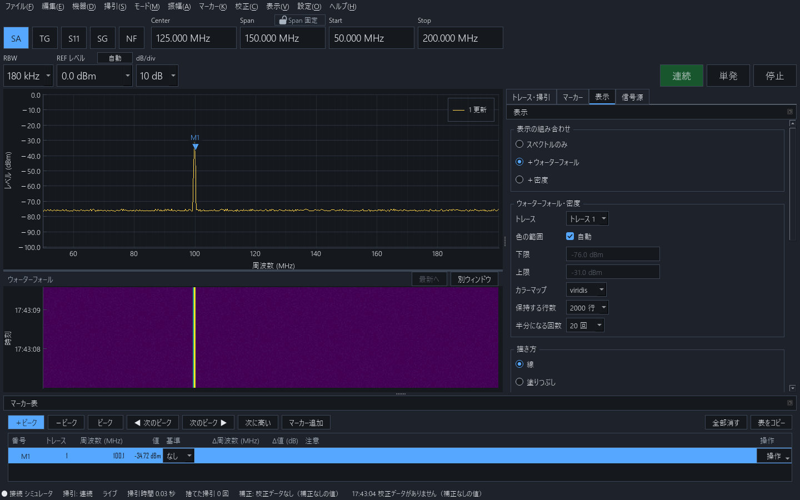

<p align="center">
  <picture>
    <source media="(prefers-color-scheme: dark)" srcset="assets/logo/namibench_logo_dark.png">
    
  </picture>
</p>

# NamiBench

自作スペクトラムアナライザ **GigaSt v5** を PC から操作するアプリです。設定して、掃引して、マーカーで読む、という計測器と同じ流れで使えます。

| 機器 | 使えるモード |
| --- | --- |
| GigaSt v5 | SA（スペクトラムアナライザ）・TG（伝送特性）・S11（反射）・SG（信号源）・NF（NF 測定） |
| PlutoSDR | SA・TG・S11・SG、外部 IQ 送信 |
| RTL-SDR のドングル | SA だけ（受信専用）、聞く、rtl_tcp |
| シミュレータ | 機器が無くても画面と操作を試せます |

デスクトップの画面のほかに、同じ PC やスマートフォンのブラウザからも同じ機器を操作できます。


開発中のため、メニューの「機器 → 自己診断の結果」はまだ使えません。

画面の写しは、どれも機器の代わりにシミュレータへ繋いで撮ったものです。

## 目次

- [必要なもの](#必要なもの)・[インストール](#インストール)・[起動と接続](#起動と接続)
- [画面の見方](#画面の見方)・[数値の入れ方](#数値の入れ方)
- [掃引の条件](#掃引の条件)・[掃引を動かす](#掃引を動かす)・[縦軸](#縦軸)・[トレース](#トレース)・[マーカー](#マーカー)・[ピークの一覧](#ピークの一覧)
- モード: [SA](#sa信号を見る)・[TG](#tg通過特性を測る)・[S11](#s11反射を測る)・[SG とステップ掃引](#sg-とステップ掃引)・[NF](#nf雑音指数を測る)・[ゼロスパン](#ゼロスパン)
- [ウォーターフォールと密度表示](#ウォーターフォールと密度表示)・[バンドプランとブックマーク](#バンドプランとブックマーク)
- [保存・開く・書き出し・PNG](#保存開く書き出しpng)・[記録と再生](#記録と再生)・[プリセット](#プリセット)
- [校正](#校正)・[単位・外部補正・周波数オフセット](#単位外部補正周波数オフセット)
- [RTL-SDR](#rtl-sdr)・[PlutoSDR](#plutosdr)・[ブラウザから使う](#ブラウザから使う)
- [画面の並びと別ウィンドウ](#画面の並びと別ウィンドウ)・[設定](#設定)・[キー操作](#キー操作)
- [うまくいかないとき](#うまくいかないとき)・[設定とデータの置き場所](#設定とデータの置き場所)

## 必要なもの

- Windows 10 / 11（Linux・macOS 用の `setup.sh` もありますが、確かめているのは Windows だけです）
- [Python 3.13](https://www.python.org/downloads/)（64 ビット版）
- 機器と、その機器のドライバ
  - **GigaSt v5**: FTDI の USB シリアルのドライバ。Windows は挿すと自動で入ることが多いです。入らないときは FTDI の VCP ドライバを入れます
  - **RTL-SDR**: `rtlsdr.dll`（64 ビット版）と、[Zadig](https://zadig.akeo.ie/) で入れ替えた WinUSB のドライバ
  - **PlutoSDR**: Analog Devices の libiio（v0.26 以降の Windows 64 ビット版）

## インストール

1. Python 3.13 を入れます。
2. このリポジトリを取ってきます。`git clone https://github.com/imenihs/NamiBench.git` か、GitHub の「Code → Download ZIP」で取って展開します。
3. 取ってきたフォルダの `setup.bat` をダブルクリックします。フォルダの中に `venv` を作り、必要なパッケージを入れます。

Python が見つからないと言われたときは、Python の場所を付けて動かします（PowerShell では `.\setup.bat`）。

```bat
setup.bat C:\path\to\python.exe
```

Linux / macOS では `./setup.sh`（Python を指定するときは `./setup.sh /path/to/python3`）を動かします。

## 起動と接続

`run.bat` をダブルクリックします。Linux / macOS では `venv/bin/python -m namibench` を動かします。

- 起動すると、前回使った機器に自動で繋ぎます（「前回の GigaSt に繋ぎました」と1回出ます）。シミュレータには自動で繋ぎません
- 繋げないときは機器の一覧が開きます。使う機器の［接続］を押します。何も挿していなければ［シミュレータで試す］で試せます
- 別の機器に替えるときはメニューの「機器 → 機器に接続…」、切るときは「機器 → 切断」です
- 機器の一覧の状態の意味:

| 状態 | 意味 |
| --- | --- |
| 使えます | 繋げます |
| 使用中 | いまこのアプリが繋いでいます |
| 前に使った機器 | 前に繋いだことがある機器です |
| ほかのアプリケーションが使っています | GS5.exe などが COM ポートを使っています。閉じてから［接続］を押します |
| 初めての機器 | 繋ぐ前に GigaSt かどうかを確かめてから繋ぎます |
| DLL が見つかりません | RTL-SDR・PlutoSDR の DLL がありません（[RTL-SDR](#rtl-sdr)・[PlutoSDR](#plutosdr)） |

- USB を抜くと「切断・再接続待ち」になり、同じ機器を挿し直すと戻ります
- GigaSt は USB 給電なので、USB の抜き挿しは電源の入れ直しになります。TG・SG の出力レベルは電源を入れるたびに変わります

## 画面の見方


- **上段**: Center・Span・Start・Stop・RBW・REF・dB/div と、右端の［連続］［単発］［停止］です。TG では［基準を取る］、S11 では［オープンを測る］［ショートを測る］も出ます。掃引に1秒より長くかかるときは、進み具合の棒と割合が出ます
- **グラフ**: 波形を描きます。操作は次の表のとおりです
- **マーカー表**: グラフの下にあり、マーカーの周波数とレベルを読みます
- **右のタブ**: 「トレース・掃引」「マーカー」「表示」「信号源」の4つです
- **画面の下端**: 接続の状態、TG・SG の出力中、記録中、注意などが出ます

| グラフの操作 | 動き |
| --- | --- |
| 横にドラッグ | その範囲を Start・Stop にする（拡大） |
| 周波数軸の上でホイール | カーソルの位置を中心に拡大・縮小 |
| レベル軸の上でホイール / ドラッグ | REF を1目盛ずつ / 連続で動かす |
| レベル軸の上で Ctrl+ホイール | dB/div を1段切り替える |
| クリック / ダブルクリック | 近いトレースにマーカーを置く |
| 右クリック | 「ここを Center に」「ここにマーカー」「REF をここに」「ここを X1 に」「ここを X2 に」「ここをブックマークに…」など |
| マウスを置く | いちばん近いトレースの点の周波数とレベルが出る |
| ファイルをドラッグ&ドロップ | そのファイルを開く |

使えない項目は消さずに灰色にしています。灰色の項目にマウスを置くと、使えない理由が出ます。

## 数値の入れ方

- 単位を付けて打てます（`1.2G`・`300k`・`1500`）。単位を省くと、その欄の単位として読みます
- Enter・Tab・欄を離れると決まります。Esc で打つ前の値に戻ります
- ↑↓ とホイールは、カーソルのある桁を増減します。ホイールで変わるのはクリックして選んだ欄だけです（スクロールでうっかり変わりません）
- 機器が受け付けない値は近い値に合わせ、「◯◯MHz に合わせました」と1回出ます
- 条件の変更は Ctrl+Z で戻し、Ctrl+Y でやり直せます（メニューの「編集」）

## 掃引の条件

- **Center・Span・Start・Stop**: どちらの組で入れても構いません。Span に `0` を入れると[ゼロスパン](#ゼロスパン)です
- **Span 固定**: Span の欄の「Span 固定」を入れると、Center・Start・Stop を変えても幅を保ちます。外していると、Center を変えたときは Center を保ち、範囲を超える分だけ Span を縮めます
- **RBW**: GigaSt は 180kHz・30kHz・15kHz です。使えない RBW は一覧に灰色で残り、理由が出ます（TG・S11・NF と、Span が 50MHz を超えるときは 180kHz だけ）。欄が注意の色になったときは、ツールチップに読み方の注意が出ます
- **点数**（「トレース・掃引」タブ）: 既定は自動です。手動では最大 12000 点まで選べます
- **掃引時間の見積もり**（「トレース・掃引」タブ）: いまの条件で1画面にかかる時間です
- **イメージ除去**（「トレース・掃引」タブ）: GigaSt が掃引ごとに出す偽の山を、何回か測って消します。「正確」「スピード」「なし」から選び、それぞれの見積もりの秒が出ます。短い時間だけ出る信号も消えるので、そういう信号は「なし」と最大保持で見ます

## 掃引を動かす

- ［連続］（F5）: 掃引を続けます
- ［単発］（F6）: 1画面だけ掃引して止まります。押すたびに平均・保持に1画面ずつ足します
- ［停止］（F7）: いまの掃引の終わりで止めます
- Pause キーで連続と停止を切り替えます

## 縦軸

- **REF**: グラフのいちばん上の目盛線のレベルです。打つか、一覧（+20〜−120dBm）から選びます
- **dB/div**: 1目盛の大きさ（1・2・5・10dB）です。REF と dB/div を変えても、測った値は変わりません
- **自動**: 表示中のトレースの最大値が、上から1目盛下に来るように REF を合わせます（メニューの「振幅 → REF レベルを波形に合わせる（自動）」も同じです）

## トレース

「トレース・掃引」タブで、トレース 1〜4 を行ごとに決めます。

| 欄 | 選べるもの |
| --- | --- |
| 表示 | グラフに出すか |
| 動作 | 更新・最大保持・最小保持・平均・固定（更新しない） |
| 回数 | 平均・保持の回数（1〜10000、または回数なし） |
| 平均の種類 | パワー（既定）・対数・電圧。対数はノイズが約 2.5dB 低く読めます |
| N 回に達した後 | 平均は「続ける（指数平均）」か「N 回ごとにやり直す」、保持は「保持し続ける」か「N 回で止める」 |
| 線 | 細線・実線・太線・破線・点線 |
| クリア | このトレースの蓄積を捨てる |

- 周波数軸・RBW・モード・イメージ除去・校正データ・基準などを変えると、値の意味が変わるので蓄積を捨て、トレースの行に「条件変更でリセット」と出ます。REF・dB/div・色を変えても捨てません
- **参照トレース**: 開いた保存ファイルのトレースをグラフに重ねます（[保存・開く](#保存開く書き出しpng)）。一覧の［外す］でグラフから外します

## マーカー

マーカーには P（ピーク。ピーク追従を持てる）と M（手動。周波数を固定）があり、それぞれ8個まで置けます。

### 置く・動かす

- グラフをクリックするか `M`（マウスの位置）で置きます。周波数を打っても置けます
- `P` で選んでいるマーカーをいちばん高いピークへ、`[` `]` で左右の次のピークへ動かします。メニューの「マーカー」には「次に高いピーク」と、いちばん高いピークに M を足す「マーカーを追加（ピークに M）」もあります
- `←` `→` で1点ずつ（Shift を付けると10点ずつ）動かします。これらのキーはグラフの上で効きます
- 「＋ピーク／−ピークを切り替える」で谷を探すようにできます（ボタンが「−ピーク」「次の −ピーク」に変わります。ノッチや S11 の共振を読むとき）
- **ピーク追従**（「マーカー」タブ）: 掃引ごとに近くのピークを探し直します（P だけ）

### 読む

- マーカー表に周波数とレベルが出ます。セルをダブルクリックすると周波数を直せます
- **デルタ**: 行の「デルタの基準」で別のマーカーを選ぶと、その行に Δ周波数・Δ値が出ます
- **オフセット**: 選んでいるマーカーから「周波数 +Δf / −Δf / ±Δf」や「レベル +ΔdB / −ΔdB / ±ΔdB」の線を出し、元との差を読みます
- **XY カーソル**: 周波数の縦線 X1・X2 とレベルの横線 Y1・Y2 を自由に置き、ΔX・ΔY を読みます（ドラッグか数値で）
- **マーカーの機能**:
  - 「N dB 帯域幅」: 下端・上端・帯域幅・中心・Q を出します。2つ目の N を入れるとシェープファクタも出ます（−3dB 帯域幅なら N に 3）
  - 「しきい値との交点」: そのレベルを超える範囲の幅を出します（例: S11 で SWR 2 以下の帯域）
  - 「交点の線をグラフに出す」で、交点を薄い線で出します

### 条件を変える

マーカーの行・右クリック・メニューから、「マーカーの周波数を Center に」「マーカーの値を REF レベルに」「デルタの2点を Start・Stop に」ができます。

### 消す・写す

Delete で選んでいるマーカーを消します。「マーカーを全部消す」「マーカー表をコピー（タブ区切り）」もあります。

## ピークの一覧

「マーカー」タブの「ピークの一覧」で、表示範囲の山（または谷）を一覧にします。

- SA では「ノイズフロアから」何 dB 高い山を、TG・S11 では「最大から」何 dB までの山・谷を並べます
- 行の［P に登録］でマーカーにし、「上位 N 個に P を置く」でまとめて置きます。行から Center にもできます
- SG・TG・S11 のときは、GigaSt の内部の漏れの周波数に「内部の漏れ」の印が付きます

## SA（信号を見る）

1. メニューの「モード → SA（スペクトラムアナライザ）」（Ctrl+1）にします。
2. GigaSt の SP 入力に、測る信号を入れます。
3. Center と Span（または Start と Stop）を打ちます。例: Center `433.92M`、Span `2M`。
4. ［連続］で掃引し、`P` でピークにマーカーを付けて読みます。

0Hz 付近には局発の漏れの帯（入力の信号ではありません）が出ます。負の周波数の側は正の周波数の鏡です。

## TG（通過特性を測る）

フィルタやアンプの周波数特性を測ります。GigaSt の TG は 1〜4000MHz です。

1. メニューの「モード → TG（伝送特性）」（Ctrl+2）にします。
2. 測る範囲を Start・Stop で決めます。
3. 被測定物だけを外し、TG 出力と SP 入力を繋ぎます。ケーブルやアッテネータは測るときと同じものを使います。
4. 上段の［基準を取る］を押します。基準が取れると、グラフが 0 dB 付近の線になります。
5. TG 出力と SP 入力の間に被測定物を入れます。グラフが基準との比（dB）になります。
6. マーカーの「N dB 帯域幅」などで読みます。

### ノーマライズの基準（「信号源」タブ）

- 基準は名前を付けて何個も持てます。一覧から1つを選んで使い、名前を変えたり消したりできます。アプリを閉じても残ります
- ［広く取る］は TG の範囲を 1MHz 刻みで取ります（上段の［基準を取る］と同じ）。0.2dB 級の精度が要るときは、［いまの条件で細かく取る］でいまの範囲だけ取り直します
- **基準の値**: 基準を取るときに dB の値を足せます。例えば、アンプの利得を測るときに測るときだけ 40dB のアッテネータを入れるなら `+40` を入れます。あとから「基準の値…」で直せます
- 基準は、取ったときのイメージ除去と RBW のときだけ使えます。合わないと比ではなく受けた電力（dBm）で出て、理由が出ます
- 基準の範囲の外の点は「値なし」になり、線が切れます
- GigaSt の電源を入れ直すと（USB の抜き挿し）出力レベルが変わるので、基準に「電源の入れ直し前」の印が付きます。取り直してください

## S11（反射を測る）

外付けの方向性結合器を使って、リターンロス・|Γ|・SWR を測ります（位相は測れません）。

1. メニューの「モード → S11（反射）」（Ctrl+3）にします。
2. 結合器の、被測定物を繋ぐ端子にオープンを繋ぎ、上段の［オープンを測る］を押します。
3. オープンを外してショートを繋ぎ、［ショートを測る］を押します。
4. 被測定物を繋ぎます。


- 縦軸はリターンロス・|Γ|・SWR から選びます。|Γ|・SWR の縦軸は下端が決まっているので、REF はありません
- S11 から出たり、電源を入れ直したり、イメージ除去や周波数軸を変えたりすると、測ったオープンは捨てられます。オープンから測り直します

## SG とステップ掃引

### SG（Ctrl+4）

- 「信号源」タブの「SG 周波数」で周波数を決めて出します（GigaSt は 1〜4000MHz）。GigaSt では出力レベルを変えられません
- 出していないときは、その原因（「SG モードではないので出力していません」など）が出ます
- 「周波数を変えたら最大・最小保持を消す」で、SG の周波数を変えたときに保持を消すかを決めます

### ステップ掃引（「信号源」タブ）

SG の周波数を1段ずつ動かしながら掃引し、結果を重ねます。周波数変換器の特性を見るときや、フィルタの形を細かく見るときに使います。

- 「SG 開始」「SG 終了」「刻み」「1段の回数」「重ね方」（最大保持・平均・全部重ねる）「結果のトレース」を決めて、［ステップ掃引を始める］を押します
- 止めるときは［停止］を押します。そこまでの結果は残ります
- 終わると SG の周波数は始める前に戻り、結果は固定のトレースとして残ります

SG・TG・S11 のときは、GigaSt の内部の漏れの周波数にグラフの上端で印が付きます（「内部の漏れの印」で消せます）。

## NF（雑音指数を測る）

ノイズ源の ON/OFF を掃引ごとに切り替えて、Y 係数法で NF を出します（Ctrl+5）。

- 「信号源」タブの「NF」で ENR を入れます。周波数ごとの ENR は「CSV を読み込む…」で表を読みます（1列目が周波数、2列目が ENR）
- 要る機器（約 80dB のアンプとイメージ除去の BPF）とつなぎ方は「NF 測定のつなぎ方…」で見られます
- 平均はトレースの「平均」で決めます
- NF の増幅度は「校正 → NF の増幅度…」で測ります

## ゼロスパン

Span に `0` を入れると、横軸が時間になります（時刻は推定です）。

- 「表示」タブの「表示する長さ」で、掃引1回・1秒・10秒・60秒を選びます
- マーカーで時刻とレベルを、XY カーソルで Δ時間・Δレベルを読みます
- X1〜X2 の区間（無ければ表示範囲）の最大・最小・パワー平均が表に出ます
- 周波数を使う操作（Center に、N dB 帯域幅、ピークの一覧、ウォーターフォールなど）は使えません

## ウォーターフォールと密度表示

「表示」タブの「表示の組み合わせ」で、「スペクトルのみ」「＋ウォーターフォール」「＋密度」を選びます（メニューの「表示 → ウォーターフォール」「表示 → 密度表示」でも切り替えます）。境目をドラッグすると高さを変えられます。



- **ウォーターフォール**: 1回の掃引を1行として上に足していきます。行をクリックすると、その時刻の掃引を「過去の掃引」としてスペクトルに重ねます。左の時刻の目盛の上をドラッグするとその時間の範囲を、ホイールで前後を見ます。［最新へ］で最新に戻ります
- **密度表示**: 直近の掃引で、各周波数・レベルに何回来たかを色で出します。ときどき出る信号や揺れる信号が見えます
- 「ウォーターフォール・密度」の欄で、使うトレース、色の範囲（自動か下限・上限）、カラーマップ（viridis・cividis・magma・inferno・灰色）、保持する行数、密度の「半分になる回数」を決めます

## バンドプランとブックマーク

「表示」タブの「バンドプラン・ブックマーク」で、周波数帯の色分けとブックマークをグラフに重ねます。

- ［読み込む…］［書き出す…］で JSON のファイルを読み書きします。グラフの右クリックの「ここをブックマークに…」でブックマークを足せます。ブックマークの［Center に］でそこへ移ります
- ファイルの形（周波数は Hz の整数、色は `#rrggbb`。空の見本は `namibench/core/bandplan_sample.json`）:

```json
{"format": "pygigast-bandplan", "version": 1,
 "bands": [{"name": "430MHz 帯", "start_hz": 430000000, "stop_hz": 440000000, "color": "#4fa3ff"}],
 "bookmarks": [{"name": "ビーコン", "hz": 434500000}]}
```

## 保存・開く・書き出し・PNG

| 操作 | キー | 中身 |
| --- | --- | --- |
| 保存… | Ctrl+S | トレース・マーカー・条件・校正・基準を HDF5（`.h5`）に保存します。h5py・MATLAB・HDFView などで読めます。メモを付けられます |
| 開く… | Ctrl+O | 保存ファイルを参照トレースとして重ねます。記録のファイルは再生します。何個でも開けます |
| CSV に書き出す… | Ctrl+E | 周波数の範囲（いまの表示・数値で指定・全部の点）とトレースを選んで書き出します。1行目に測定の条件が入ります |
| PNG を保存 | Ctrl+P | グラフ・マーカー表・測定の条件を1枚の画像にします。ファイル名を1回知らせ、そこからフォルダを開けます |
| PNG をクリップボードへ | Ctrl+Shift+C | 同じ画像をクリップボードへ置きます |

PNG の大きさ・配色（ユーザー指定・ライト・ダーク）・保存先は「設定」の「保存」で、画像の下端に焼き込む1行のメモは「表示」タブの「PNG」で決めます。

## 記録と再生

- メニューの「ファイル → 記録を開始」で掃引を続けて記録し、「記録を止める」で止めます。「記録をまとめる…」で保存ファイル（HDF5）にします
- 記録は1回の掃引ごとに作業ファイルへ書くので、アプリや PC が落ちても直前の掃引まで残ります。まとめる前に終わった記録は、次の起動で「まとめる…」「捨てる…」「あとで」を聞きます
- 記録のファイルを開くと再生します。ウォーターフォールの下の帯で［再生］［一時停止］、速さ（等倍〜30 倍）、時間のつまみを使い、［ライブに戻る］で測定に戻ります
- 「ファイル → 記録を切り出す…」「ファイル → 記録を CSV に書き出す…」で、選んだ時間の範囲（選んでいなければ全体）と、いまの周波数の表示の範囲を書き出します
- ゼロスパン・NF の区間がある記録は再生できません

## プリセット

よく使う条件に名前を付けて保存し、呼び出します。

- 「ファイル → いまの状態をプリセットに保存…」で保存し、「ファイル → プリセット…」で呼び出し・上書き・名前の変更・削除をします
- 入るもの: モード・Start/Stop・RBW・点数・イメージ除去・SG の周波数・REF・dB/div・単位・外部補正・トレースの動作と回数・平均の種類・表示の組み合わせ・周波数オフセット
- 入らないもの: 校正データとノーマライズの基準
- 呼び出したあとも Ctrl+Z で元に戻せます

起動したときは、プリセットとは別に、前回閉じたときの状態に戻ります。

## 校正

メニューの「校正」から、手順を案内する画面で校正します。「準備 → 測る → 確かめる → 保存」の順に進み、保存するまで何も変わりません。前の校正データは履歴に残ります。

| メニュー | 要る機器 | 中身 |
| --- | --- | --- |
| 周波数特性と全体のレベル… | 外部の SG・ケーブル | 外部の SG の出力を SP 入力へつなぎ、案内される周波数ごとに測ります。測れない点は飛ばせます |
| RBW… | ケーブル 1 本 | TG 出力と SP 入力を直結して、RBW ごとの差を自動で測ります |
| NF の増幅度… | 6dB のアッテネータ | アッテネータを入れた状態と外した状態で測ります |
| PlutoSDR の利得の補正… | 30〜40dB の減衰器・ケーブル 2 本 | PlutoSDR の TX から減衰器を通して RX へつなぎます |
| 旧校正ファイルを読み込む… | 旧校正ファイル | GS5.exe の校正ファイル（`gigast.txt` / `ba205.txt` と個別補正データ）を取り込みます |

旧校正ファイルは、いま繋いでいる GigaSt に取り込みます。GS5.exe の設定ファイルと保存ファイルは読めません。

## 単位・外部補正・周波数オフセット

- **単位**（「表示」タブの「振幅の詳細」）: dBm・dBμV・dBmV（50Ω で換算）。TG・S11 で基準との比を出している間は dB、NF の間は dB（NF）になります
- **外部補正**（同じ欄）: 外付けのアッテネータ・アンプの分を足します（10dB の減衰なら `+10`）。0 でないときは画面の下端に出ます
- **描き方**（「表示」タブ）: 線か塗りつぶし
- **周波数オフセット**（「トレース・掃引」タブ）: 変換器の出力を見るときに、表示する周波数を「測った周波数 + オフセット」にします（負も可）。機器へ送る周波数は変わりません。CSV には測った周波数も残ります

## RTL-SDR

### 準備

1. Zadig で、ドングルのドライバを WinUSB に入れ替えます。
2. `rtlsdr.dll`（64 ビット版）を、アプリのフォルダの `rtlsdr` フォルダに置きます。別の場所に置いたときは、「設定」の「RTL-SDR」で［フォルダを選ぶ…］からそのフォルダを選びます。
3. ドングルを挿すと、機器の一覧に出ます。

### 使い方

- 受信専用です。TG・S11・SG・NF は使えません
- レベルは「dB（未校正）」で、絶対値（dBm）ではありません
- 「トレース・掃引」タブの「受信（RTL-SDR）」で、受信の利得（手動の段か AGC）と周波数の補正（ppm）を決めます。［利得を合わせる］で、見えている信号が振り切れない最大の利得を選びます
- **個体の校正**: マーカーを既知の周波数の信号に置いて［ppm をこの信号で合わせる］、既知のレベルの信号に置いてレベルを合わせると、その利得の段は dBm で出ます。シリアル番号ごとに保存します
- RBW の窓は Hann（細かく分けて見る）と Flat top（レベルを正確に読む）から選びます
- **聞く**（「マーカー」タブ）: 選んでいるマーカーの周波数を AM・FM狭・FM放送・USB・LSB で復調して音にします（メニューの「マーカー → 選んでいるマーカーの位置を聞く」「聞くのをやめる」も同じです）。聞いている間は掃引が止まります
- **rtl_tcp**（「設定」の「rtl_tcp」）: ［送り出す］を入れると、SDR# などのソフトから RTL-SDR として使えます。受ける接続は「この PC からだけ」か「同じネットワークのほかの PC からも」です。相手がつながっている間は掃引しません。GigaSt からも送れますが、送るのは信号の強さだけなので、外のソフトで聞けるのは AM だけです

## PlutoSDR

### 準備

1. libiio の DLL 一式（`libiio.dll` と、同じフォルダにある DLL）を、アプリのフォルダの `libiio` フォルダに置きます。別の場所に置いたときは、「設定」の「PlutoSDR」でそのフォルダを選びます。
2. PlutoSDR を USB で繋ぐと、機器の一覧に出ます（`ip:192.168.2.1` で探します。変えるときは「設定」の「PlutoSDR」の「URI」で）。

### 使い方

- レベルは「dB（未校正）」です。「校正 → PlutoSDR の利得の補正…」で利得の段の差を補正できます
- 「トレース・掃引」タブの「受信（PlutoSDR）」で受信の利得（手動か自動）を決めます。［利得を合わせる］は RTL-SDR と同じです
- SG・TG・S11 の出力の強さは、「信号源」タブの「送信（PlutoSDR）」の「送信の減衰」で決めます
- 「TG 高調波の平均除去」（なし・4回・8回）で、TG・S11 の揺れを減らします。比の床（深く測れる限界）は下がらないので、深く測るときは送信の出口に測る帯に合ったフィルタ（BPF か LPF）を入れます
- 「設定」の「PlutoSDR」の「基準の補正」で、機器の基準の周波数のずれを直します
- **外部 IQ 送信**（「設定」の「外部 IQ 送信」）: ［受け付ける］を入れると、ほかのアプリが TCP で送った IQ を PlutoSDR から送信します。SA のモードのときに使えます。最小のクライアントの例は `tools/ext_iq_client.py` です。送信は必ずケーブルと減衰器で被測定物へつなぎ、空中に出さないでください

## ブラウザから使う

この PC のブラウザから使うときは、`--web` を付けて起動し、`http://127.0.0.1:8080/` を開きます（「設定」の「ブラウザから使う」の「この PC のブラウザから使う」でも入れられます）。

```bat
run.bat --web
```

- スマートフォンや別の PC から使うときは、「設定」の「ブラウザから使う」で「同じネットワークのスマートフォンや PC からも使う」を入れます。QR コード（操作できる・見るだけの2つ）・URL・6桁の認証番号が出るので、スマートフォンのカメラで QR コードを読むか、URL を開いて認証番号を入れます。認証番号は 2 分で無効になります
- 接続のしかたは「設定 → ブラウザからの接続のしかた…」で開き直せます（新しい認証番号が出ます）。画面の下端の「ブラウザから接続 …」から、つながっている相手の一覧・切断・認証の作り直しができます
- 「同じネットワークのスマートフォンや PC からも使う」は、アプリを起動するたびに切れています。使うときにもう一度入れます
- 暗号化（HTTPS）はしていません。信頼できないネットワークでは使わないでください。インターネットには公開しないでください
- ブラウザの画面はデスクトップの画面と同じ構成・同じ操作です。保存・書き出し・PNG はブラウザへのダウンロードになり、開くファイルはブラウザから送ります。DLL のフォルダなど PC の場所を指す設定は、デスクトップの画面で変えます
- 画面なしで動かすときは `run.bat serve`（スマートフォンからも使うなら `run.bat serve --lan`）です。URL・QR コード・認証番号はコンソールに出て、Enter で新しい認証番号、`r` と Enter で認証を作り直します

## 画面の並びと別ウィンドウ

- グラフとマーカー表の境目、右のパネルの幅はドラッグで変えられます（次の起動でも残ります）
- グラフ・マーカー表・右のタブ（タブごと）・ピークの一覧は、別ウィンドウに出せます。閉じると元の位置に戻ります
- 別ウィンドウを見失ったときは、メニューの「表示 → 並びを初期に戻す」で戻します

## 設定

メニューの「設定 → 設定…」で開きます。変えるとすぐ効きます。各項目の［初期値に戻す］で戻せます。

| ページ | 中身 |
| --- | --- |
| 接続 | 覚えた機器（次の起動で自動で繋ぐ機器）と［忘れる］、「COM 番号で繋ぐ（GigaSt）」 |
| 配色 | 画面の色を1つずつ変える、ライト・ダークの初期値にする、名前を付けて保存・読み込み・ファイルに書き出す・取り込む。読みにくい組み合わせには ⚠ が出ます |
| 通知 | 窓で知らせるもの（「次から出さない」にしたものをここで戻す） |
| キー操作 | キーの割り当て（[キー操作](#キー操作)） |
| 保存 | 保存・開くの最初のフォルダ、PNG の保存先・大きさ・配色 |
| ブラウザから使う | この PC のブラウザから使う・ポート番号・同じネットワークのスマートフォンや PC からも使う・接続のしかたを表示 |
| rtl_tcp | 送り出す・ポート番号・受ける接続 |
| 外部 IQ 送信 | 受け付ける・ポート番号 |
| RTL-SDR | rtlsdr.dll のフォルダ |
| PlutoSDR | libiio.dll のフォルダ・URI・基準の補正 |

配色は「表示 → 配色…」からも開けます。

## キー操作

| 操作 | デスクトップの画面 | ブラウザ |
| --- | --- | --- |
| 連続 / 単発 / 停止 | F5 / F6 / F7 | R / S / X |
| 連続と停止を切り替える | Pause | Pause |
| モード SA / TG / S11 / SG / NF | Ctrl+1〜5 | Alt+1〜5 |
| マーカーをピークへ（グラフの上で） | P | P |
| 次のピーク（左 / 右） | `[` / `]` | `[` / `]` |
| マーカーを1点動かす（Shift で10点） | ← / → | ← / → |
| マウスの位置に M を置く | M | M |
| 選んでいるマーカーを消す | Delete | Delete |
| 条件の変更を戻す / やり直す | Ctrl+Z / Ctrl+Y | Ctrl+Z / Ctrl+Y |
| 開く / 保存 / CSV に書き出す | Ctrl+O / Ctrl+S / Ctrl+E | Ctrl+O / Ctrl+S / Ctrl+E |
| PNG を保存 / クリップボードへ | Ctrl+P / Ctrl+Shift+C | Ctrl+P / Ctrl+Alt+C |
| 終了 | Ctrl+Q | — |

- 入力の欄にいる間は、文字・数字・矢印のキーは欄に渡します
- 割り当ては「設定 → キー操作…」で変えられます。行を選んでキーを押し、ぶつかるときは付け替えるかを聞きます。デスクトップの画面とブラウザで別々に覚えます
- いまの割り当ての一覧は「ヘルプ → キー操作の一覧」で見られます。アプリの版は「ヘルプ → NamiBench について」で見られます

## うまくいかないとき

| こうなる | 確かめること |
| --- | --- |
| 機器の一覧に GigaSt が出ない | USB ケーブル（給電だけのケーブルではないか）と FTDI のドライバ。それでも出ないときは「設定」の「接続」の「COM 番号で繋ぐ（GigaSt）」で COM 番号を入れます |
| 「ほかのアプリケーションが使っています」と出る | GS5.exe など、同じ COM ポートを使うアプリを閉じてから［接続］を押します |
| 「DLL が見つかりません」と出る | RTL-SDR・PlutoSDR の DLL の場所と、64 ビット版かどうか |
| TG・S11 で比ではなく dBm が出る | 基準がいまの RBW・イメージ除去と合っていません。基準を取り直します |
| TG のレベルが前と合わない | USB の抜き挿し（電源の入れ直し）で出力レベルが変わります。基準を取り直します |
| 使えない項目が灰色になっている | 灰色の項目にマウスを置くと、使えない理由が出ます |
| 別ウィンドウが見つからない | メニューの「表示 → 並びを初期に戻す」 |

## 設定とデータの置き場所

設定・覚えた機器・校正・基準・プリセット・配色は、Windows では `%APPDATA%\NamiBench`、Linux・macOS では `~/.namibench` にあります。

## ライセンス

[MIT](LICENSE.md)
